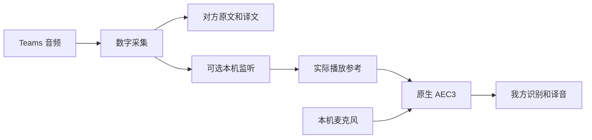

# AED Translator V0.3 开发与验收计划

2026-11-27

V0.3 的首要验收场景是同一间会议室里，主电脑负责 Teams 的会场收音和外放，个人电脑加入同一场会、关闭本机播放与麦克风，AED 仍能从个人电脑的 Teams 收到音频并显示字幕。第二个验收场景是笔记本开外放的双向翻译，远端语音到达字幕，并且远端回声不会反过来触发我方译音。API 设置页标明各端点的可用地区，由用户手动选择。

## 公司实测反馈

- V0.2.8 的 Teams 自动取流和回声补偿在实际使用中未达到要求。本机播放音量为零或扬声器关闭时，也观察到在线会议没有数据。此前离线报告验证了合成音采集和指定 SoundWire 回环，真实 Teams 的取流与双讲一直缺少通过证据。
- 普通「自动」与「自动允许混音」的差别给实际使用带来困惑。V0.3 对在线会议只保留一个「自动」，并显示当前音源、不可用原因和需要的一次性设置。
- 面对面需要同场中、日、英切换，字幕和设置要达到在线会议的可用性。邮件报告说话人分配混乱；截图记录了区间超过 30 秒、起点缺失、结束位置早于已发送 PCM，以及翻译重放超时。
- 使用反馈提到 Qwen 在部分网络环境连接不稳。API 设置页需要区分大陆端点和国际端点，方便用户选择。

## 当前代码的限制

- Teams 专用回退在探测进程 PCM 前先要求 Windows 会话电平达到阈值。如果静音影响了该电平，路径会跳过 Teams 专用探测并回到普通应用选择。报告中观察到的收音失败仍需用实际 PCM 对照定位。[Windows Auto](../../electron/windows-audio-utils.js)
- 当前软件补偿在约 600 ms 的窗口内寻找高相关片段，用估计的单一增益相减。真实外放中的混响、设备延迟变化和双讲都可能让参考匹配变差。此前的离线麦克风降幅也包含浏览器回声抑制的作用。[现有回声补偿](../../src/lib/audio/capture/meetingEcho.ts)
- 面对面直接加载 Qwen，并使用音频区间重放补齐第二语种。界面将上游标识顺序映射为说话人编号；这层映射缺少对标识中途变化的校正。[面对面运行时](../../src/lib/faceToFace/runtime.ts) · [字幕映射](../../src/lib/faceToFace/captions.ts)
- QwenCloud 已有大陆和新加坡端点，AED 的百炼专属工作空间地址目前支持北京。地区标签应标在具体端点旁，同一提供商的不同端点可以分别标注。[Qwen 接入地址](../../src/providers/qwen_livetranslate/endpoints.ts)

## 参考项目与取舍

| 参考 | V0.3 用途 | 需要验证 |
| --- | --- | --- |
| [OBS Studio 的 Windows WASAPI 实现](https://github.com/obsproject/obs-studio/blob/master/plugins/win-wasapi/win-wasapi.cpp)与[微软 Application Loopback 样例](https://github.com/microsoft/Windows-classic-samples/tree/main/Samples/ApplicationLoopback) | 同一场 Teams 的进程采集对照。核对进程树、采样格式、重新绑定和采集生命周期。 | OBS 和 AED 均使用 Windows 进程回环 API。若两边都读不到有效 PCM，应验证独立播放设备。 |
| [WebRTC Audio Processing Module](https://webrtc.googlesource.com/src/+/refs/heads/main/api/audio/audio_processing.h)与 [AEC3](https://webrtc.googlesource.com/src/+/refs/heads/main/modules/audio_processing/aec3/) | 首选回声消除引擎。原生侧向 APM 提供约 10 ms 的参考和麦克风帧，按实际播放和采集时间对齐。 | 在相同的外放参考下与浏览器「全部」比较远端串音、双讲保真、CPU 和延迟。 |
| [Windows AEC Bridge](https://github.com/nVitius/windows-aec-bridge)与 [SpeexDSP](https://github.com/xiph/speexdsp) | 前者用来参考 Windows 原生收音、AEC3 和虚拟线缆的接法，后者用作轻量算法对照。 | 在 V0.3 原生助手中做小型验证，核查依赖、许可证和 Windows x64 构建。 |
| [sherpa-onnx](https://github.com/k2-fsa/sherpa-onnx) | 利用现有本地推理体系评估说话人分段与嵌入，按会话维护匿名编号。 | 本地候选模型需通过中日英换语、多人和重叠讲话测试，以及 16 GB 笔记本性能验收。 |

## P0 · Teams 数字收音与静音入会

1. **建同场对照。** 在可控 Teams 测试会中用相同的标记样本比较 AED V0.2.8、OBS 和微软进程回环样例。分别测试正常外放、物理扬声器音量为零、物理扬声器静音或禁用、Teams 应用自身输出音量为零，以及 Teams 未连接会议音频。记录 Teams 进程树、会话音源、应用与设备音量、实际 PCM 帧数、非静音比例、首帧时间、设备切换和断流原因。Windows 文档区分端点的前／后音量回环，静音结果以公司设备实测为准。[WASAPI 回环](https://learn.microsoft.com/en-us/windows/win32/coreaudio/loopback-recording) · [前／后音量回环](https://learn.microsoft.com/en-us/windows-hardware/drivers/audio/ksproperty-audioloopback)
2. **重做 Auto 选择依据。** 以明确的 Teams 进程身份启动有超时的采集探针，实际收到的 PCM 决定是否连接。Windows 应用电平用于定位与诊断，去掉它在可信 Teams 进程 PCM 前的硬门槛。跟随会话重启和设备切换，仍保留物理端点路径的归属与其他应用音频检查。
3. **实测独立 Teams 接收链路。** 如果进程回环在公司设备仍无有效 PCM，原型使用受管环境允许的独立虚拟播放设备。Teams 的扬声器选择该设备，其配对输入进 AED，个人电脑的物理监听可关闭。现有送译音给 Teams 麦克风的通路使用另外一条线，按端点身份检查两条线没有接回同一对。首次只需在 Teams 中选择一次设备，AED 记住配置。若现场已有主机负责收音，个人电脑使用「仅对方字幕」，关闭个人麦克风和译音送出。独立虚拟设备需要能在公司终端上部署，Teams 自身退出音频会话时提示用户检查连接状态。[Teams 音频设备设置](https://support.microsoft.com/en-us/teams/notifications-settings/manage-your-device-settings-in-microsoft-teams) · [VB-Audio 虚拟设备](https://vb-audio.com/Cable/)
4. **合并设置。** 界面统一显示「自动」，保留 `auto-meeting-audio`。旧的允许混音选择迁移到新的 Auto，具体路径显示为 Teams 进程、Teams 专用线路或已验证的输出端点。同一端点出现未知或竞争音频时暂停往翻译发送。高级诊断保留手动选源并解释当前等待原因。

把进程回环、独立设备和输出端点做成同一套音源候选，按身份、隔离性和 PCM 质量选择。Teams 专属逻辑负责识别 Teams 的会话和进程树；浏览器或其他会议软件可以使用同一采集流程。音源变化时重查采集和回声参考。

## P0 · 外放双向会议的回声消除

- 第一轮在 Windows 原生音频助手中独立采集物理播放参考，并按设备音量和静音状态调整。AEC3 使用锁定版本的 Sonora WASM，在 10 ms 帧上处理。Teams 字幕的数字音源与 AEC 参考分开维护。物理参考不可用时保留浏览器处理。实机还需验证设备延迟、时钟漂移和双讲。[Sonora](https://github.com/dignifiedquire/sonora)
- 先在离线回放和可控外放中对比浏览器「全部」、当前简化补偿以及原生 AEC3。启用 AEC3 的通路使用同一份近端输入和可观测的参考，避免重复施加浏览器和原生 AEC。切换后保留浏览器模式用于降级或 A/B，参考丢失、静音、拔插设备分别测试。
- AEC 调试只记录源角色、后端、参考是否连续、时间差、时钟漂移、丢帧、处理耗时和前后电平等数字。源选择、回声抑制和翻译请求各自可观测。关闭本机监听的「仅对方字幕」通路只验证 Teams 数字音源和字幕，外放双向通路另测近端音质与回声。

## API 设置 · 可用地区

在「账号与密钥」的 API 端点名称旁显示地区标签，沿用现有设置目录、凭据保存方式和连接检查。端点由用户手动选择和保存。地区标签说明服务商支持范围，当前办公网能否连通以连接检查为准。

| 设置页标签 | 适用端点 |
| --- | --- |
| 中国大陆可用 | 百炼北京 Qwen 3.8、QwenCloud 大陆端点。百炼工作空间使用对应的区域凭据。[百炼地域与端点](https://help.aliyun.com/zh/model-studio/regions/) |
| 国际可用（限服务商支持地区） | OpenAI 官方 API、QwenCloud 新加坡端点。[OpenAI 支持地区](https://developers.openai.com/api/docs/supported-countries) · [Qwen 接入地址](../../src/providers/qwen_livetranslate/endpoints.ts) |

OpenAI 兼容自定义端点的可用范围取决于用户填入的地址。

## 工作模式

| 工作模式 | 开始会话前的能力检查 |
| --- | --- |
| 在线会议仅看对方字幕 | Teams、浏览器或指定应用有隔离的数字音源，所选线路能返回原文和目标语言的流式字幕。个人电脑可以关闭实体麦克风与监听。 |
| 在线会议双向翻译 | 远端数字音源和本机麦克风可用，线路支持双方所选语言方向和目标语种译音，译音输出独立于远端采集。外放验证 AEC 参考；耳机验证近端语音不被误抑制。固定音色按端点、模型和凭据单独确认。 |
| 面对面 | 一只麦克风即可使用，按双语或中日英设置展示原文和译文。说话人编号在会话内独立维护；无法确定时显示状态，字幕流继续。 |
| 会后纪要 | 沿用独立的文本服务配置与凭据。 |

## P1 · 面对面中日英与服务复用

1. **先修长段和重连。** 由本地采样序号维护每段音频的范围，优先沿停顿切段，连续讲话时按上限有界切段。规范回退或缺失的云端时间戳，处理重复、乱序和已发送区间，限制队列长度和重试次数。译文失败时保留原文，下一段继续。覆盖截图对应的四类错误以及长场录音。当前 `30000 ms` 报错来自 AED 的 Qwen 音频缓冲保护。
2. **复用设置和提供商。** 把面对面当前直接读取 Qwen 的运行时改为按所选提供商启动。两模式共享凭据、连接测试和诊断入口，面对面的语言组合、字幕输出和设备选择按其用途持久化。先打通 Qwen 和 OpenAI 的字幕路径，复用网络诊断与重连行为。[OpenAI 实时翻译](https://developers.openai.com/api/docs/guides/realtime-translation)
3. **保留双语并加入三语。** 增加「中日英」预设，按段识别原文语言，原文优先展示，按已选目标补充译文。同一个人换语时保留说话人编号。为控制多路成本，优先验证一次转写并分发必要文本译文。已有实时翻译通路用于达到延迟目标的服务和语言组合，按目标语种开独立音频流时分别记重试与用量。[OpenAI 每目标一个翻译会话](https://developers.openai.com/api/docs/guides/realtime-translation)
4. **稳定说话人编号。** 上游说话人标识变化时先在本会话内校正，不确定或重叠讲话时允许显示「未确定」。用 sherpa-onnx 的本地嵌入与聚类做对照，优先测同人换语、两到三人快速交替、暂停后重开口。能正确分配同一人比显示更多编号更重要。说话人能力随本地实测确定，OpenAI 翻译接入和本地说话人编号独立验收。[sherpa-onnx 说话人分段 C API](https://github.com/k2-fsa/sherpa-onnx/blob/master/sherpa-onnx/c-api/docs/speaker-diarization.dox)

## V0.3 发布验收

| 项目 | 验收证据 |
| --- | --- |
| 同场静音入会 | 受管 Windows 笔记本连接真实 Teams 音频，个人电脑的物理监听关闭，仍能为一段标记语音持续生成对方原文和译文。重复测物理音量为零和设备切换，并确认主电脑可以正常外放。 |
| 外放双向与双讲 | 同输入比较 V0.2.8 与 AEC3，测远端单讲残余回声、双讲近端词句完整率、对方内容误入我方译音的次数。建议目标为测试用例里无对方原文被译回，同等条件下我方双讲原文可懂度不低于 V0.2.8，新增音频处理延迟 P95 ≤ 30 ms。 |
| Auto 与隔离 | 单个 Auto 选项能复用旧配置。Teams 数字音源、端点切换、通知声、另一个应用出声、未知来源与断流均有可读状态。涉及混音的回退不将竞争音频交给翻译端。 |
| API 地区提示 | 设置页按端点显示地区标签，手动选择后能够保存，既有连接检查可用。 |
| 面对面与服务 | 中日英同场、多轮换语、两三人交替、30 秒以上发言和断线恢复可复现。Qwen 和 OpenAI 各跑一轮，测首条字幕延迟、连续 30 分钟内翻译失败率、误拼接、说话人误跳与重试后的重复用量。原有配置与字幕选项可恢复。 |
| 交付软件 | Windows x64 单包，AED 版本 V0.3.0，界面简称 V0.3，沿用原有配置目录。单次诊断覆盖所选采集路径、静音状态、AEC 前后、提供商就绪和断流原因，诊断 TXT 中只有本地测量与状态。 |

### 第一轮 Windows 预览验证

- 第一轮构建曾使用 `0.3.0` 版本号，当时面对面四项仍未实现，正式发布验收未通过。此构建按第一轮技术预览记录。后续面向测试的构建使用 `0.3.0-beta.2` 标识。
- 自动音源直接探测可信 Teams 进程的 PCM，覆盖 Windows 会话电平为零或缺失、但可收到音频的测试用例。已安装额外 VB-CABLE A/B/C/D 时，可在 Teams 设对应的 `CABLE-X Input` 为扬声器，在 AED 设对应的 `CABLE-X Output` 为对方音源。标准 `CABLE Input` 仍用于向会议发送译音。
- 本机播放固定测试音时，进程回环和独立扬声器参考同时收到 PCM。Sonora 合成双讲样本的远端单讲区间，回声能量下降 24.9 dB。两次本机 Realtek 外放单讲测试中，参考电平不同，麦克风 RMS 分别下降 37.5 dB 和 15.0 dB。最后一次用交付的预览版和现有配置，64 个麦克风块经过 AEC3。样本和诊断均在本机处理。
- Windows 构建、预览版启动和 456 个相关测试已通过。发布验收仍需覆盖受管电脑上的真实 Teams 静音取流、外放双讲，及不同扬声器和麦克风组合。

### 面对面 Beta 2 的实现范围

- 双语选择和中日英预设按本机配置保存。翻译服务可选 Qwen 或 OpenAI，复用账号与密钥页的凭据，以及音频设置的麦克风和降噪。显式开始面对面收音会使用选定麦克风，在线会议的静音设置独立保留。
- Qwen 主目标保持流式字幕，其他目标仅在需要时用有界音频重放。缺失时间戳使用本地已发送的 PCM 边界，长段分为短于 30 秒的重放。OpenAI 主目标走实时翻译，其他目标基于定稿原文补译。
- 编号只使用会话的原文说话人信号。同一个提供商说话人 ID 换语时沿用编号。一行中出现冲突时显示「说话人未确定」。OpenAI 实时翻译当前也以「未确定」显示缺失的说话人信息。本地声学分人的评估和真实多说话人验收仍在发布检查范围内。
- Beta 2 通过 24 个测试文件、261 项相关回归。Windows x64 成品沿用正常配置启动，验证了在线会议和面对面入口之间的切换。两家实时云服务的字幕测试使用模拟响应，真实云服务与公司的 Teams 现场验收仍待完成。

冻结 V0.2.8 与对照样本后，先验证 Teams 静音取流，取得稳定数字源后完成 AEC3 与双讲测试。API 地区标签可以并行完成。面对面先修长段与设置复用，再接中日英和说话人稳定化。按发布验收表统一交付 V0.3，合成数据继续用于自动回归。
